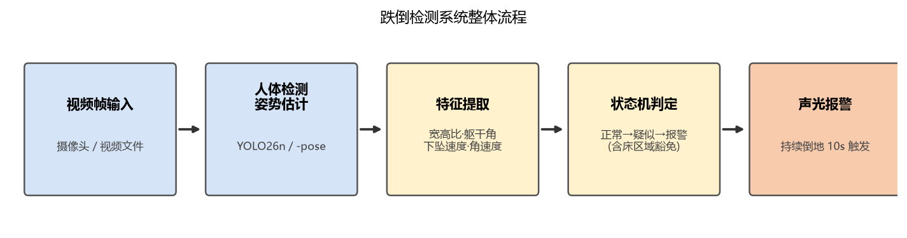
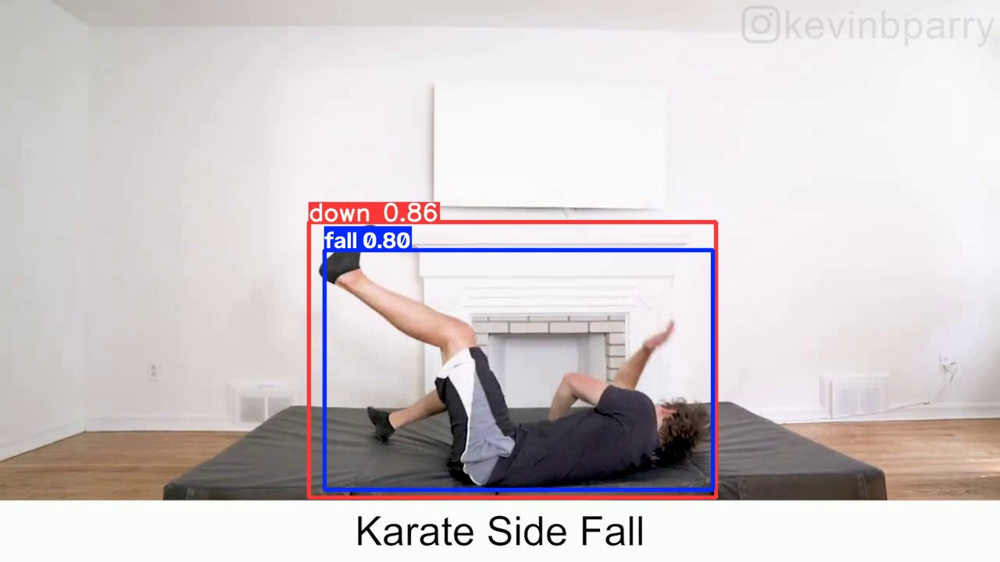

# 老人防摔智能识别系统

> 独居老人跌倒检测系统：电脑摄像头实时分析人体姿势，确认摔倒后本地报警并向手机 App 推送警报（响铃 + 全屏警报 + 现场截图 + 自动拨打家属电话），支持手机远程查看实时监控画面。端到端延迟约 2~3 秒。

本项目为「Vibe Coding」（AI 协作编程）课程作品：几乎全部代码由 AI 助手编写与调试，人负责需求定义、效果验收与方向决策。完整论文见 `01_项目汇报/`。

## 核心成果

- **三条可对比的技术路线**：① 姿势关键点 + 规则判断；② 端到端自训练检测模型；③ 几何 + 运动学双重判据确认
- **自训练跌倒检测模型**：YOLO26n 在 374 张跌倒图片上微调 30 轮（纯 CPU 48 分钟），fall 类 **mAP@50 = 0.97、召回率 = 0.958**，权重仅 5.4 MB
- **多判据融合方案**：地板语义分割（SegFormer-b0）+ 三维姿势估计（MediaPipe 33 关键点），在 UR Fall 公开数据集上 3D 引擎检出率 **7/8 vs 2D 的 4/8**，日常活动**零误报**
- **完整报警闭环**：摔倒确认 → ntfy 推送 → 自研 Android App 响铃弹屏（含现场截图）→ 自动拨打紧急联系人 → App 内实时 MJPEG 监控画面

## 系统流程

```
视频帧 → 人体检测/姿势估计 → 特征提取 → 状态机判定 → 声光报警 → 手机推送/电话
```



## 三条技术路线对比

| 路线 | 原理 | 优点 | 缺点 |
|------|------|------|------|
| ① 姿势+规则 | 关键点 → 宽高比/躯干角/下坠速度规则 | 可解释、无需训练 | 阈值依赖场景，鲁棒性一般 |
| ② 自训练检测模型 | YOLO26n 在跌倒数据集上微调，直接输出 fall 类 | 准确率高、逻辑简单 | 黑盒、需要标注数据 |
| ③ 运动学确认 | 姿态几何 + 躯干贴地 + 角速度/下落速度（3D 版为竖直性速率）多重判据 | 可解释、能区分"摔倒/自行躺下/弯腰" | 对关键点抖动敏感 |

### 关键技术点

- **摔倒 vs 睡觉**：单帧水平姿态无法区分，引入时间维度（重心下坠速度）+ 空间维度（床区域 ROI 标定）+ 状态机（正常 → 疑似 → 报警）
- **摔倒 vs 弯腰**：躯干角会重叠，最终方案是"躯干三点贴地校验"——地板语义分割 + 距离场，髋/肩/头三点全部贴地才进入运动学确认；弯腰时手能摸地但躯干三点悬空，直接排除
- **2D 盲区**：人朝镜头方向摔倒时投影躯干角几乎不变，引入 MediaPipe 33 三维关键点，核心指标为**躯干竖直性** verticality = |Δy| / |三维躯干向量|（站立 ≈ 0.9，任何方向躺倒 ≈ 0.1）
- **跌倒确认双判据**：峰值重心下落速度 v > 0.30（画面高度/秒）**或** 峰值躯干角速度 ω > 60°/s ⇒ 确认摔倒；"或"逻辑必要——前扑悬空瞬间 v=0 但 ω=150°/s，单判据会漏检

## 自训练模型（Model Card）

| 项目 | 内容 |
|------|------|
| 模型 | `04_模型与数据/best.pt`（YOLO26n 微调） |
| 架构 | YOLO26n（nano 级，Backbone C3k2+SPPF+C2PSA / Neck PAN-FPN / Head 三尺度解耦，端到端免 NMS） |
| 权重体积 | **5.4 MB**（对照开源 YOLOv11-Le2i 为 16 MB） |
| 输入尺寸 | 640 × 640 |
| 输出类别 | fall（躺倒）/ standing（站立）/ sitting（坐着） |
| 训练方式 | COCO 预训练权重 + 374 张跌倒图片微调 30 epochs，batch 8，lr0 0.01，纯 CPU（i5-12600KF）48 分钟 |
| 推理速度 | CPU 约 67 ms/帧 |
| 数据集 | HuggingFace `DeZan/fall-detection`（374 训练 / 111 验证，YOLO 格式），已随仓库提供 |

### 验证集指标（111 张）

| 类别 | Precision | Recall | mAP@50 | mAP@50-95 |
|------|-----------|--------|--------|-----------|
| **fall（关键类）** | **0.883** | **0.958** | **0.970** | 0.762 |
| standing | 0.717 | 0.551 | 0.664 | 0.439 |
| sitting | 0.692 | 0.632 | 0.736 | 0.554 |
| 全部 | 0.764 | 0.714 | 0.790 | 0.585 |

fall 类是唯一需要高可靠的类别（漏报代价远大于误报）；standing/sitting 仅作干扰项，不影响报警逻辑。


### 消融对比（同一段真实摔倒视频，504 帧）

| 模型 | person 检出 | **fall 检出** | fall 最高置信度 |
|------|------------|--------------|----------------|
| 微调前 `yolo26n.pt`（COCO 80 类，无 fall 类） | 504/504 | **0** | — |
| 微调后 `best.pt`（本项目） | — | **244/504** | **0.94** |
| YOLOv11-Le2i（开源对照） | — | 28 帧（片段内）、断断续续 | 0.68 |

## 2D vs 3D 姿势引擎对比（UR Fall 数据集）

完全相同的判定链（姿态持续 0.5s → 躯干三点贴地 → 运动学确认），仅替换姿势引擎：

| 指标 | 2D（YOLO26n-pose） | 3D（MediaPipe） |
|------|--------------------|-----------------|
| 摔倒检出率 | 4/8 | **7/8** |
| 日常活动误报 | 0/4 | 0/4 |

关键发现：倒地后出画/遮挡及俯拍机位的 4 段视频 2D 全部漏检、3D 全部检出；2D 与 3D **漏检样本互不重叠**，双引擎融合理论可达 8/8 检出且零误报（后续方向）。



## 报警与 App 端

- **推送管道**：ntfy.sh 开放协议，紧急优先级 + 现场截图合并单条消息，4G 外网可达
- **自研 Android App**（Kotlin，零第三方依赖）：前台服务 SSE 长连接订阅；收到警报即循环响铃 + 震动 + 全屏红色警报页（锁屏可弹出），内嵌现场截图与监控入口；5 秒后自动拨打预设紧急联系人（本机 SIM 卡，零费用）
- **实时监控**：检测端内置轻量 HTTP 服务器以约 12 fps 推 MJPEG 流（叠加骨架与判定信息），App 内逐帧解码播放
- **兜底通道（预留）**：4G 电话模块（SIM800C，AT 指令拨号 + 中文 TTS 播报）、阿里云语音服务 TTS 电话报警（代码就绪，需企业资质开通）

## 目录结构

```
├── 01_项目汇报/     课程论文（PDF 成品 + Markdown 源文件）
├── 02_源代码/
│   ├── PC端/        检测、报警、推送、训练等全部 Python 源码
│   └── 手机App端/   Android 报警接收端源码（Kotlin）
├── 03_编译成品/     【未入库】Windows 成品与 APK 见 Releases
├── 04_模型与数据/   自训练权重 best.pt、训练曲线、跌倒数据集、数据配置
├── 05_论文素材/     论文全部插图（结构图、训练曲线、实测截图）
└── 06_教学案例/     本项目转化的教学案例文档
```

### 主要源码文件

| 文件 | 说明 |
|------|------|
| `02_源代码/PC端/pose_action_demo.py` | **最终整合版主程序**（姿势识别 + 运动学确认 + 地板贴地校验 + 报警推送 + 监控视频流） |
| `02_源代码/PC端/fall_detect.py` | 姿势+规则版实时检测（含床区域标定、区域倒地计时） |
| `02_源代码/PC端/fall_camera.py` | 自训练检测模型版报警程序（best.pt 直检 fall 类） |
| `02_源代码/PC端/alert_push.py` | 手机推送模块（ntfy 管道，文字 + 现场截图） |
| `02_源代码/PC端/video_server.py` | MJPEG 监控视频流服务器 |
| `02_源代码/PC端/call_module.py` | 4G 电话模块拨号 + 中文 TTS 语音播报（预留硬件通道） |
| `02_源代码/PC端/aliyun_voice.py` | 阿里云语音服务 TTS 电话报警（预留云通道） |
| `02_源代码/PC端/train_fall.py` | 模型微调训练脚本 |
| `02_源代码/PC端/fall.yaml` | 数据集配置 |
| `02_源代码/手机App端/` | 自研 Android App 完整源码（报警接收、全屏警报、自动拨号、实时监控） |

## 快速运行

**电脑端（成品，免环境）**：从 Releases 下载解压后

```
FallCamera\FallCamera.exe            # 摄像头模式
FallCamera\FallCamera.exe 视频.mp4   # 视频测试模式
```

**手机端**：安装 APK → 确认「推送通道: 已连接 ✓」→ 把监控视频流地址改成电脑实际 IP（如 `http://192.168.1.2:8080/video.mjpg`）→ 电池设为「不限制」、允许自启动

**源码二次开发**：

```powershell
python -m venv .venv
.\.venv\Scripts\pip install ultralytics opencv-python mediapipe
.\.venv\Scripts\python.exe 02_源代码\PC端\pose_action_demo.py   # 注意按注释调整模型路径
```

## 开发环境

- 硬件：AMD RX 7700 XT（12GB）、Intel i5-12600KF、64GB 内存
- 软件：Windows 11、Python 3.11、Ultralytics 8.4.152、PyTorch 2.14（CPU 版）
- 模型：YOLO26n-pose（官方姿势估计）、YOLO26n（自训练检测）、MediaPipe Pose Landmarker（三维姿势）、SegFormer-b0（地板语义分割）

## 已知不足

- 角速度对关键点抖动敏感（需 3~5 帧滑动平均平滑）
- 多人拥挤 + 频繁镜头切换场景下追踪 ID 稳定性是瓶颈
- 检测模型对训练数据未覆盖的摄像头角度（如正俯视）泛化待验证
- 低分辨率（320×240）下关键点可用率显著下降，部署建议 720p 及以上
- 3D 竖直性在"半倒半撑"过渡姿态存在中间态（0.3~0.5），阈值附近判定需更细致的状态机或时序模型

## Vibe Coding 方法论小结

1. 现象描述质量决定调试效率（"摔倒了但一直显示 OK"+ 时间点，一次定位到时间基准 bug）
2. 让 AI 写诊断工具而不是盲猜——逐帧测量日志比口头分析快
3. 里程碑式验收：每轮迭代用真实素材验收，问题暴露在早期
4. AI 也会引入 bug，人必须保留最终验收权；重要版本自己留备份

## 参考资料

- Ultralytics YOLO 官方文档：https://docs.ultralytics.com/
- UR Fall Detection Dataset（Kwolek & Kepski, 2014）
- 数据集：HuggingFace `DeZan/fall-detection`（MIT License）
- 对照模型：GitHub `SyedBurhanAhmed/Real-Time-Fall-Detection-using-YOLO`（MIT License）
- SegFormer（NeurIPS 2021）/ BlazePose（CVPRW 2020，MediaPipe）
